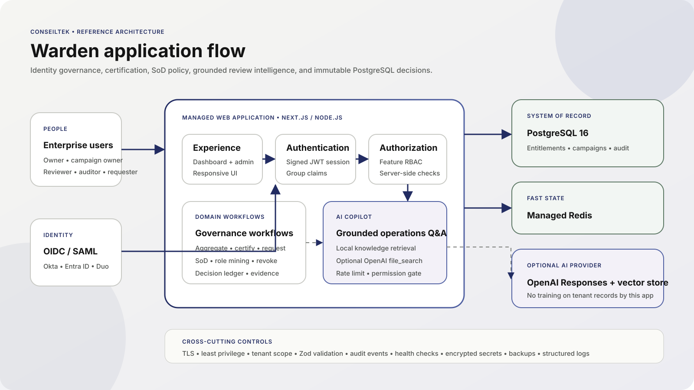

<p align="center"></p>
<h1 align="center">Warden</h1>
<p align="center"><strong>Access reviews that finish, on data you can audit.</strong></p>

[](https://github.com/ConseilTek-Tektons/warden/actions/workflows/ci.yml) [](https://github.com/ConseilTek-Tektons/warden/actions/workflows/codeql.yml) [](LICENSE)

Warden is a deployable identity-governance reference application for entitlement aggregation, access requests, certification campaigns, segregation of duties, role mining, and verified revocation. See the [product rationale and honest parity matrix](https://conseiltek.com/techtons/warden).



## Working scope

- PostgreSQL identity warehouse covering identities, applications, entitlements, assignments, campaigns, certification items, and an append-only decision ledger
- Server-authorized `/api/campaigns` read/create workflow and reviewer-risk calculation
- Feature RBAC for governance administrators, campaign owners, reviewers, application owners, policy managers, requesters, and auditors
- OIDC with step-up for sensitive actions; SAML via Keycloak; group-to-role mappings for Okta, Entra ID, and Duo
- Grounded governance Q&A with reviewer context and SoD evidence; no AI grant, certification, policy, or revocation actions
- Responsive ConseilTek interface aligned with the current website design

## Run locally

```bash
cp .env.example .env.local
docker compose up -d postgres redis keycloak
pnpm install --frozen-lockfile
pnpm db:migrate && pnpm db:seed
pnpm dev
```

## Deploy

- `infra/aws`: App Runner, Aurora PostgreSQL Serverless v2, ElastiCache Serverless, private evidence storage, SQS, Secrets Manager, and CloudWatch
- `infra/azure`: App Service Web App for Containers, PostgreSQL Flexible Server, Azure Managed Redis, private Blob Storage, Storage Queue, Key Vault, and Monitor

Warden requires authenticated server execution and managed PostgreSQL; static web hosting is not used.

## Documentation

[Architecture](docs/ARCHITECTURE.md) · [Authentication](docs/AUTHENTICATION.md) · [RBAC](docs/RBAC.md) · [AI](docs/AI.md) · [Security](docs/SECURITY.md) · [Operations](docs/OPERATIONS.md)

Warden is designed, built, and maintained by [ConseilTek](https://conseiltek.com) under Apache 2.0. Contact [support@conseiltek.com](mailto:support@conseiltek.com).
