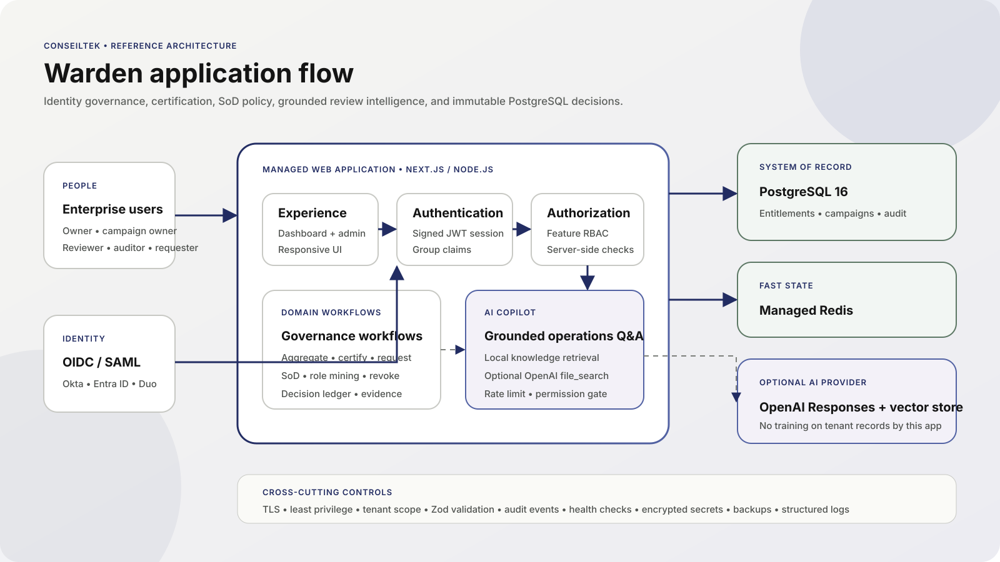
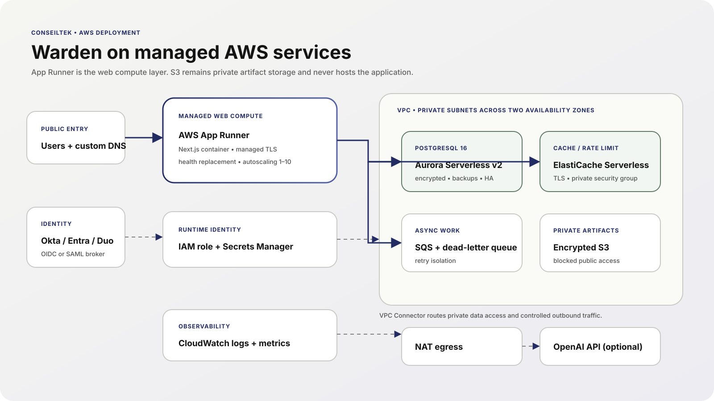
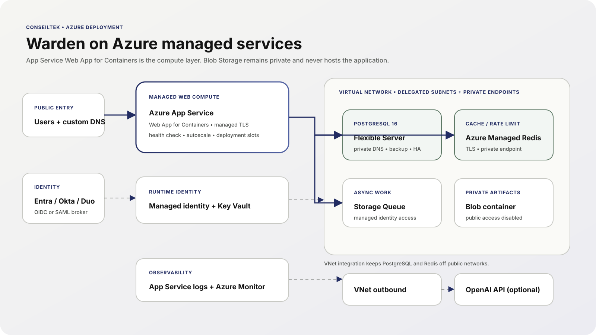

# Warden architecture

Warden is a server-rendered identity-governance application with authenticated APIs, feature RBAC, a PostgreSQL 16 entitlement warehouse, optional Redis, append-only decisions, and grounded assistance.

Source aggregation correlates accounts to identities and writes assignments. Campaign generation freezes a review scope. Reviewers receive contextual, permission-filtered items; decisions append to an immutable ledger. Revocation is not complete until a connector receipt exists and a later aggregation verifies removal. AI can explain risk and policy but cannot grant, certify, revoke, or publish policy.

AWS uses managed container compute, Aurora PostgreSQL, Redis, queues, secrets, and private evidence storage. Azure uses App Service Web App for Containers, PostgreSQL Flexible Server, Azure Managed Redis, queues, Key Vault, and private Blob Storage. Production evidence retention should enable S3 Object Lock or Azure immutable blob policy according to the operator's retention requirement.

Static website hosting is not part of either design.
